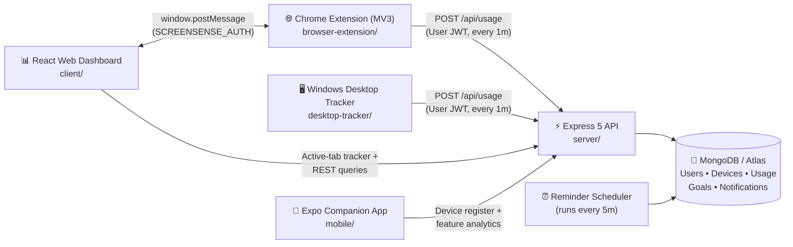

<div align="center">

# 🧠 ScreenSense AI

**Because opening VS Code for 10 minutes and watching YouTube Shorts for 3 hours should probably not count as "coding all day."**

[](https://react.dev/)
[](https://expressjs.com/)
[](https://www.mongodb.com/)
[](https://tailwindcss.com/)
[](https://developer.chrome.com/docs/extensions/mv3/)
[](https://expo.dev/)

A full-stack digital wellbeing, screen-time tracking, and productivity analytics platform that gently exposes where your day actually went—across your browser, Windows desktop, and companion mobile app.

[Architecture](#-architecture-in-30-seconds) • [Quick Start](#-quick-start-speedrun) • [Trackers](#-how-the-trackers-spy-politely-on-you) • [Math & "AI"](#-the-math-behind-the-ai) • [API Reference](#-rest-api-reference)

</div>

---

## 🤔 Why ScreenSense AI?

Most screen-time trackers tell you *"You spent 4 hours on Chrome."* Thanks, super helpful. Were you grinding job applications on LinkedIn, or were you 47 Reels deep into raccoon videos at 2 AM?

**ScreenSense AI** breaks usage down to the **app + activity** level (e.g., `YouTube → shorts` vs. `YouTube → search`, `VS Code` vs. `Discord`), crunches deterministic productivity & focus scores, tracks daily/weekly goals with streaks, runs linear-regression forecasts for tomorrow, and ships it all to a sleek dark-mode-first dashboard.

> [!NOTE]
> **Reality Check (No Hype Zone):** Despite "AI" in the name, there is **no TensorFlow, PyTorch, or LLM burning GPU credits here**. All insights, forecasts, and scores are fast, deterministic, rule-based + linear regression math computed right on your Node server. Zero hallucinations guaranteed.

---

## 🗺️ Architecture in 30 Seconds

Five workspaces, one MongoDB source of truth, zero excuses:



### Two Ways Usage Hits the Backend

1. **Direct User-JWT Ingestion (`POST /api/usage`)** — Used by the Chrome extension, the Windows desktop tracker, and the dashboard's built-in session tracker (`useDashboardSessionTracker`). Authenticates with your `7d` user JWT.
2. **Idempotent Device Sync (`POST /api/usage/sync`)** — Built for registered device clients (`POST /api/devices/register`). Uses `15m` device-scoped access tokens, rotating `bcrypt`-hashed refresh tokens (`POST /api/devices/refresh`), and batch uploads (1–500 events) deduplicated by `(deviceId, idempotencyKey)` so offline retries never double-count your doomscrolling.

---

## 📦 Repository Tour

```text
ScreenSense-AI/
├── 🌐 browser-extension/       # Chrome MV3 extension (active tab & site activity tracking)
│   ├── manifest.json           # Permissions: tabs, storage, alarms, windows
│   ├── background.js           # URL classifier, focus-aware timer, 1-min alarm uploader
│   └── dashboard-auth.js       # Content script that snags your dashboard JWT automatically
│
├── 📊 client/                  # React 19 + Vite 8 + Tailwind v4 web dashboard
│   ├── src/components/         # Auth forms, Dashboard widgets, AppAnalytics, Hero, UI kit
│   ├── src/context/            # UIContext (dark/light theme + localStorage profile)
│   ├── src/hooks/              # useFeatureAnalytics, useDashboardSessionTracker, useNotifications
│   ├── src/pages/              # Landing, Auth, and 8 authenticated Dashboard views
│   ├── src/routes/             # React Router 7 + ProtectedRoute
│   └── src/services/api.js     # Fetch client talking to VITE_API_URL
│
├── 🖥️ desktop-tracker/         # Node.js ESM Windows foreground app tracker
│   └── tracker.js              # Polls active window every 1s via get-windows, flushes every 1m
│
├── 📱 mobile/                  # Expo SDK 57 (React Native 0.86) companion app
│   ├── App.jsx                 # Login, SecureStore session, today's screen time & score
│   └── src/
│       ├── api.js              # Auth, device registration, analytics fetch
│       └── tracking.js         # Honest platform boundary notice (Android/iOS native limits)
│
└── ⚡ server/                  # Express 5 + Mongoose 9 REST API
    ├── app.js                  # Helmet, CORS, rate limiting, JSON limit (100kb), routes
    ├── server.js               # HTTP server + DB bootstrap + 5-min reminder scheduler
    ├── config/db.js            # MongoDB Atlas connection & helpful error diagnostics
    ├── controllers/            # Auth, Usage, Dashboard, Productivity, Analytics, Goals, Insights, Devices, Notifications
    ├── middlewares/            # protect (user JWT) & protectDevice (device JWT)
    ├── models/                 # User, Usage, Device, Goal, Notification
    ├── routes/                 # Modular Express routers
    ├── scripts/                # migrateUsageIndex.js (repairs legacy idempotency index)
    ├── services/               # reminderService.js (goal threshold alerts)
    └── utils/                  # classification.js
```

---

## 🛠️ Tech Stack

| Piece | What Powers It |
| :--- | :--- |
| **Web Dashboard (`client/`)** | React 19, Vite 8, React Router 7, Tailwind CSS v4, Recharts 3, Framer Motion, Lucide Icons, Axios, React Hot Toast, React CountUp |
| **Backend (`server/`)** | Node.js (CommonJS), Express 5, Mongoose 9, `jsonwebtoken`, `bcryptjs` / `bcrypt`, `helmet`, `cors`, `express-rate-limit`, `dotenv` |
| **Database** | MongoDB / MongoDB Atlas |
| **Browser Tracker (`browser-extension/`)** | Chrome Manifest V3 (`tabs`, `storage`, `alarms`, `windows`) |
| **Desktop Tracker (`desktop-tracker/`)** | Node.js (ESM), `get-windows`, `axios`, `dotenv` |
| **Mobile App (`mobile/`)** | Expo ~57, React Native 0.86, React 19, `expo-secure-store` |

---

## 🚀 Quick Start (Speedrun)

### Prerequisites

- **Node.js** (v18+ minimum; v20+ recommended for Vite 8 & Express 5) + **npm**
- **MongoDB** (Atlas cluster or local MongoDB instance)
- **Google Chrome** (if you want browser activity tracking)
- **Windows** (for `desktop-tracker`, which tags events as `platform: "windows"`)
- **Expo Go / Emulator** (optional, for `mobile/`)

---

### Step 1: Boot the Backend (`server/`)

```bash
cd server
npm install
```

Copy `server/.env.example` to `server/.env` and fill in your secrets:

```env
PORT=5000
MONGO_URI=mongodb+srv://<user>:<password>@<cluster>.mongodb.net/ScreenSenseAI?retryWrites=true&w=majority
JWT_SECRET=replace-with-a-long-random-secret
CLIENT_ORIGINS=http://localhost:5173
NODE_ENV=development
```

Fire it up:

```bash
# Dev mode (nodemon)
npm run dev

# Production mode
npm start
```

> [!TIP]
> **Upgrading an older DB?** If your MongoDB database previously had a non-partial `deviceId_1_idempotencyKey_1` index that caused `E11000` errors on legacy uploads, run:
> ```bash
> npm run migrate:usage-index
> ```

Sanity check: visit `http://localhost:5000/api/health` — you should see `{"success":true,"database":"connected"}`.

---

### Step 2: Launch the Web Dashboard (`client/`)

```bash
cd client
npm install
```

Create `client/.env` from `client/.env.example`:

```env
VITE_API_URL=http://localhost:5000/api
```

Run it:

```bash
npm run dev      # http://localhost:5173
npm run build    # Production bundle
npm run lint     # ESLint check
npm run preview  # Preview production build
```

> [!IMPORTANT]
> **Desktop Viewport Required:** Trying to open the web dashboard on a phone-sized screen (`< 640px` wide) triggers `.mobile-unsupported` in `client/src/index.css` and displays a polite *"Desktop required"* card instead of squishing charts into spaghetti.

---

### Step 3: Load the Chrome Extension (`browser-extension/`)

1. Go to `chrome://extensions/` in Google Chrome.
2. Flip on **Developer mode** (top right).
3. Click **Load unpacked** and select the `browser-extension/` folder.
4. Open the web dashboard (`http://localhost:5173`) and sign in.
5. **Magic handoff:** `dashboard-auth.js` automatically reads your dashboard token and `API_BASE` via `SCREENSENSE_AUTH` and stores them in `chrome.storage.local`. No copy-pasting tokens needed here!

---

### Step 4: Start the Desktop Tracker (`desktop-tracker/`)

```bash
cd desktop-tracker
npm install
```

Create `desktop-tracker/.env` from `desktop-tracker/.env.example`:

```env
# Notice: NO /api at the end here!
API_URL=http://localhost:5000
# Sign in to the dashboard, open DevTools -> Application -> Local Storage, and copy "token"
JWT_TOKEN=paste-dashboard-token-here
```

Start tracking your Windows apps:

```bash
node tracker.js
```

Hit `Ctrl+C` when you're done—`SIGINT` automatically flushes any accumulated whole minutes before exiting.

---

### Step 5: Run the Mobile Companion (`mobile/`)

```bash
cd mobile
npm install
```

Create `mobile/.env` from `mobile/.env.example`:

```env
# Android Emulator: http://10.0.2.2:5000/api
# Physical Device: replace with your computer's LAN IPv4
EXPO_PUBLIC_API_URL=http://192.168.1.10:5000/api
```

Start Expo:

```bash
npm start
# Or jump straight to a target:
npm run android
npm run ios
```

---

## ⚙️ Environment Variables Cheat Sheet

| Workspace | Variable | Required | Notes |
| :--- | :--- | :--- | :--- |
| `server` | `PORT` | No | Defaults to `5000` |
| `server` | `MONGO_URI` | **Yes** | MongoDB connection string (must not contain `<placeholder>` brackets) |
| `server` | `JWT_SECRET` | **Yes** | Signs/verifies user (`7d`) & device (`15m`) JWTs |
| `server` | `CLIENT_ORIGINS` | In prod | Comma-separated frontend URLs allowed by CORS |
| `server` | `NODE_ENV` | No | Set `production` to strictly enforce `CLIENT_ORIGINS` |
| `client` | `VITE_API_URL` | No | Defaults to `http://localhost:5000/api` |
| `desktop-tracker` | `API_URL` | **Yes** | Backend origin **without** `/api` (e.g., `http://localhost:5000`) |
| `desktop-tracker` | `JWT_TOKEN` | **Yes** | User JWT from dashboard `localStorage` |
| `mobile` | `EXPO_PUBLIC_API_URL` | No | Defaults to `http://10.0.2.2:5000/api` |

---

## 🕵️ How the Trackers Spy (Politely) on You

### 1. Chrome Extension (`browser-extension/background.js`)
Tracks active tab switches, URL changes inside the same tab, and **stops the clock whenever Chrome loses window focus** (`chrome.windows.onFocusChanged`). Every 60 seconds, a `chrome.alarms` trigger flushes any app with `>= 1` whole minute to `POST /api/usage`.

How it classifies what you're doing:

| Platform | URL Pattern | Activity Label | Category |
| :--- | :--- | :--- | :--- |
| **YouTube** | `/shorts` | `shorts` | `unproductive` |
| **YouTube** | `/results` | `search` | `productive` |
| **YouTube** | Everything else | `videos` | `neutral` |
| **Instagram** | `/reels`, `/stories`, `/explore` | `reels`, `stories`, `explore` | `unproductive` |
| **Instagram** | `/direct`, everything else | `chats`, `posts` | `neutral` |
| **LinkedIn** | `/jobs` | `jobs` | `productive` |
| **LinkedIn** | `/messaging`, everything else | `chats`, `feed` | `neutral` |
| **Spotify** | `spotify.com` | `music` | `neutral` |
| **Other HTTP/HTTPS** | Any other site | `browsing` | `neutral` |

> It deliberately skips `dashboardOrigin` so your time on the ScreenSense dashboard itself isn't double-counted alongside the dashboard's built-in tracker.

### 2. Windows Desktop Tracker (`desktop-tracker/tracker.js`)
Polls `activeWindow()` every **1 second** via `get-windows`, normalizes common process names (`Chrome`, `VS Code`, `Spotify`, `Microsoft Edge`, `Firefox`, `Discord`, `File Explorer`, `Postman`), and uploads whole minutes every **60 seconds**:
- **Productive:** `VS Code`, `Postman`
- **Unproductive:** `Spotify`, `Discord`
- **Neutral:** Everything else

### 3. Dashboard Built-In Tracker (`useDashboardSessionTracker.js`)
While you're signed into the web dashboard and the tab is visible, it silently logs your active minutes every 30 seconds (and on tab hide/close with `keepalive`) under `appName: "ScreenSense AI"`, `activity: "dashboard"`, `category: "productive"`. Because staring at your own productivity charts is technically productive.

### 4. Mobile Companion App (`mobile/`)
Logs you in via `expo-secure-store`, registers your device (`POST /api/devices/register`), and shows today's screen time and productivity score.
- **Honest Boundary (`mobile/src/tracking.js`):** The JS app intentionally **does not fake** OS-level mobile app tracking—Android requires a native Kotlin `UsageStatsManager` module + Usage Access permission, and iOS requires Apple Family Controls + a Device Activity extension.

---

## 🖥️ Web Dashboard Routes

**Public**
- `/` — Landing page
- `/login` — Sign in
- `/register` — Create account
- `/forgot-password` — Password reset UI

**Protected (`/dashboard/*`)**
- `/dashboard` — **Overview:** Today's Screen Time, Productivity %, Focus Score %, Unlocks (usage events logged), Weekly Chart, Top Apps, Daily Trend, AI Recommendation, Goal Progress, and Recent Activity (auto-polls every 30s).
- `/dashboard/app-analytics` — **App Analytics:** Searchable app cards, activity breakdowns, hourly usage chart, and peak-hour stats.
- `/dashboard/behaviour` — **Behaviour:** Tracked sessions, hourly minutes/sessions timeline, 7-day behavior comparison, and top activities.
- `/dashboard/ai-insights` — **AI Insights:** Wellbeing summary, peak hour, most-used app, and rule-based tips.
- `/dashboard/predictions` — **Predictions:** Tomorrow's linear-regression screen-time forecast, confidence %, per-app expected minutes, and distraction risk gauge.
- `/dashboard/reports` — **Reports:** 4-week breakdown chart & cards with one-click **Export CSV** (`screensense-usage-report.csv`).
- `/dashboard/goals` — **Goals:** Create/delete `screen_time`, `productive_time`, or `app_limit` goals (`daily` / `weekly`), live progress bars (`on_track`, `close`, `exceeded`), and consecutive-day streak counter.
- `/dashboard/settings` — **Settings:** Edit local profile & avatar (<= 2 MB), toggle browser pop-up notifications, and switch between **Dark** and **Light** themes.

---

## 🧮 The Math Behind the "AI"

No black boxes—here is the exact math running in `server/controllers/`:

- **Productivity Score** (`productivityController.js` & `analyticsController.js`):
  $$\text{Productivity} = \text{round}\left(\frac{\text{productiveTime} \times 1 + \text{neutralTime} \times 0.5}{\text{totalScreenTime}} \times 100\right)$$
- **Focus Score** (`productivityController.js`):
  $$\text{Focus} = \text{round}\left(50 \cdot \frac{\text{productiveTime}}{\text{totalScreenTime}} + 30 \cdot \left(1 - \frac{\text{unproductiveTime}}{\text{totalScreenTime}}\right) + 20 \cdot \left(1 - \min\left(\frac{\text{contextSwitches}}{30}, 1\right)\right)\right)$$
  *(where `contextSwitches` = number of usage documents logged today)*
- **Tomorrow's Forecast** (`analyticsController.js` → `predictNextDay`):
  - Runs ordinary least-squares **linear regression** (`method: "linear_regression"`) across active days in the last 7 days, clamped at `>= 0`.
  - Confidence = `Math.min(95, activeDays.length * 14)`.
- **Goal Streak** (`goalController.js`):
  - Counts up to **30 consecutive days** (starting today) with recorded usage where daily total `<= primaryGoal.targetMinutes` (defaults to `360` minutes if you haven't created a goal yet).
- **Insights & Goal Reminders** (`insightController.js` & `reminderService.js`):
  - Evaluates today's usage against deterministic thresholds (`totalScreenTime >= 240`, `productiveTime >= 120`, `unproductiveTime >= 90`, `productivityScore >= 70` or `< 40`).
  - Background scheduler runs at startup and **every 5 minutes**, creating deduplicated 7-day-TTL notifications when daily `screen_time` usage hits `>= 80%` (near limit) or `>= 100%` (exceeded).

---

## 🗄️ Database Models & Indexes

<details>
<summary><strong>Click to expand all 5 Mongoose schemas & indexes</strong></summary>

| Model | File | Key Fields | Indexes & Notes |
| :--- | :--- | :--- | :--- |
| **User** | `server/models/User.js` | `name`, `email`, `password` | `email` unique; password hashed via bcrypt pre-save hook |
| **Device** | `server/models/Device.js` | `userId`, `installationId`, `platform` (`windows \| android \| ios`), `clientType` (`desktop \| android \| ios \| chrome`), `deviceName`, `refreshTokenHash`, `lastSeenAt`, `isActive` | Unique `{ userId, installationId }` |
| **Usage** | `server/models/Usage.js` | `userId`, `deviceId`, `source` (`legacy \| desktop \| android \| ios \| chrome`), `idempotencyKey`, `deviceType` (`laptop \| mobile`), `platform`, `appName`, `totalTime` (min), `activities` (`Map<Number>`), `category` (`productive \| unproductive \| neutral`), `date` | Partial unique `{ deviceId, idempotencyKey }` (`deviceId: objectId`, `idempotencyKey: string`) |
| **Goal** | `server/models/Goal.js` | `userId`, `goalType` (`screen_time \| productive_time \| app_limit`), `appName`, `targetMinutes`, `period` (`daily \| weekly`) | — |
| **Notification** | `server/models/Notification.js` | `userId`, `type` (`reminder \| goal \| insight`), `title`, `message`, `dedupeKey`, `readAt`, `expiresAt` | Unique `{ userId, dedupeKey }`; TTL index on `expiresAt` (`expires: 0`) |

</details>

---

## 📡 REST API Reference

Base URL: `http://localhost:5000` (all API endpoints live under `/api`).

<details>
<summary><strong>Click to expand full endpoint tables (Auth, Usage, Analytics, Goals, Devices, Notifications)</strong></summary>

### Health
| Method | Endpoint | Auth | Description |
| :--- | :--- | :--- | :--- |
| `GET` | `/` | Public | Service status message |
| `GET` | `/api/health` | Public | `{ success, database: "connected" \| "disconnected" }` |

### Auth (`/api/auth` — rate-limited to 20 req / 15 min per IP; returns `503` if DB disconnected)
| Method | Endpoint | Auth | Description |
| :--- | :--- | :--- | :--- |
| `POST` | `/api/auth/register` | Public | Register user (`name >= 2`, valid `email`, `password >= 6`) → returns `7d` JWT |
| `POST` | `/api/auth/login` | Public | Authenticate user → returns `7d` JWT |
| `GET` | `/api/auth/profile` | User JWT | Get signed-in user (password excluded) |

### Usage (`/api/usage`)
| Method | Endpoint | Auth | Description |
| :--- | :--- | :--- | :--- |
| `POST` | `/api/usage` | User JWT | Log one usage record (`deviceType`, `platform`, `appName`, `totalTime`, optional `activities`, `category`, `date`) |
| `POST` | `/api/usage/sync` | Device JWT | Batch-sync 1–500 events (`events[]`) with optional `idempotencyKey` deduplication |
| `GET` | `/api/usage` | User JWT | Fetch all usage records sorted by `date` descending |

### Dashboard & Analytics (`/api/dashboard`, `/api/analytics`)
| Method | Endpoint | Auth | Description |
| :--- | :--- | :--- | :--- |
| `GET` | `/api/dashboard/analytics` | User JWT | Today's screen time totals, category breakdown, most used app, sorted `appUsage` |
| `GET` | `/api/dashboard/activity-analytics` | User JWT | Today's grouped `activities` totals |
| `GET` | `/api/dashboard/productivity` | User JWT | Productivity score, focus score, context switches, % change vs. yesterday |
| `GET` | `/api/analytics/daily` | User JWT | Today's totals, app breakdown, 24-hour buckets (optional `?deviceType=laptop\|mobile`) |
| `GET` | `/api/analytics/weekly` | User JWT | Last 7 days breakdown & weekly total (optional `?deviceType=laptop\|mobile`) |
| `GET` | `/api/analytics/features` | User JWT | Unified 35-day dataset for App Analytics, Behaviour, Predictions, Reports, and Goals |

### Goals, Insights, Devices & Notifications
| Method | Endpoint | Auth | Description |
| :--- | :--- | :--- | :--- |
| `POST` | `/api/goals` | User JWT | Create goal (`goalType`, `targetMinutes`, optional `appName`, `period`) |
| `GET` | `/api/goals` | User JWT | List all goals |
| `GET` | `/api/goals/progress` | User JWT | Live daily progress, status (`on_track \| close \| exceeded`), and streak |
| `PUT` | `/api/goals/:id` | User JWT | Update `targetMinutes`, `period`, or `appName` |
| `DELETE` | `/api/goals/:id` | User JWT | Delete a goal |
| `GET` | `/api/insights` | User JWT | Generate today's rule-based insights & recommendation summary |
| `POST` | `/api/devices/register` | User JWT | Register/upsert device by `installationId` → returns `15m` access token + refresh token |
| `POST` | `/api/devices/refresh` | Refresh Token | Rotate refresh token & mint new `15m` device access token |
| `GET` | `/api/devices` | User JWT | List registered devices |
| `DELETE` | `/api/devices/:id` | User JWT | Soft-revoke a device (`isActive: false`) |
| `GET` | `/api/notifications` | User JWT | List latest 30 notifications |
| `PATCH` | `/api/notifications/:id/read` | User JWT | Mark a notification as read |

</details>

---

## 🔒 Security & CORS

- **Helmet & Express Hardening:** `helmet` enabled (`crossOriginResourcePolicy: "cross-origin"`), `x-powered-by` disabled, JSON payload capped at `100kb`.
- **Smart CORS Policy:** Automatically allows requests without an `Origin`, any `chrome-extension://*` origin (so the extension works even against a deployed backend), origins in `CLIENT_ORIGINS`, and all origins in non-production when `CLIENT_ORIGINS` is unset.
- **Auth Guardrails:** Passwords & device refresh tokens hashed via `bcrypt` (10 rounds); `/api/auth/*` rate-limited to **20 requests per 15 minutes**.

---

## 🚧 Known Rough Edges (Honest Engineering Notes)

- **Mobile OS Tracking:** `mobile/` displays stats and registers devices, but actual Android (`UsageStatsManager`) / iOS (`Family Controls`) background collection still requires native modules.
- **Desktop Tracker Token:** `desktop-tracker/tracker.js` still reads a manually pasted user `JWT_TOKEN` from `.env` instead of automating `/api/devices/register` + `/api/devices/refresh`.
- **Local Settings:** Profile edits, uploaded avatars, theme, and notification toggle preferences in `/dashboard/settings` live in `localStorage` rather than MongoDB.
- **UI-Only Auth Buttons:** `/forgot-password` and the *"Continue with Google"* buttons on login/register are frontend UI placeholders—no reset-email or Google OAuth backend routes exist yet.
- **Time-Zone Quirks:** Server helpers mix local midnight (`setHours(0, 0, 0, 0)`) with UTC date keys (`toISOString().slice(0, 10)`), which can shift day boundaries if your server isn't running in UTC.
